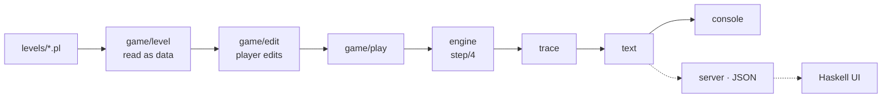

# Architecture

Closed World is a step-by-step interpreter for a subset of Prolog, written in Prolog. The engine knows nothing about the game: it runs a program and reports every step. The game layer reads levels, applies the player's edits and turns the trace into something to show.



Dashed parts are planned.

## Why not a simple meta-interpreter

```prolog
solve(true).
solve((A, B)) :- solve(A), solve(B).
solve(H) :- clause(H, B), solve(B).
```

Here backtracking happens invisibly inside Prolog: execution cannot stop at each step, show which alternatives are left or spend torch on each move. And a `!` would only cut inside the interpreter's own clause, not in the level's program. The engine makes all of that explicit instead.

## The engine

The engine is a pure transition relation, applied until the query succeeds, fails or the torch runs out:

```prolog
step(Program, Stack, Next, Event)
```

The state is a stack of nodes `node(Answer, Goals, Doors)`: the resolvent, the clauses still to try for its first goal, and the query variables with their names.

| Event | Meaning | Torch |
| :--- | :--- | :---: |
| `enter(Door, Goal)` | A clause head unifies: go down to a new room | 1 |
| `mismatch(Door, Goal, Reason)` | A clause head does not unify | 1 |
| `backtrack` | No doors left: go back | 1 |
| `cut(Doors)` | The cut closes these doors | 1 |
| `not_start(Goal)` | A ghost starts a separate search | 1 |
| `not_fails` / `not_succeeds` | The ghost's search ends | 1 |
| `trap` | Game over | 0 |
| `success(Answer)` | The treasure, with the query's bindings | 0 |

- **No `assert`, no global state.** Each attempt works on a fresh copy of the resolvent, so the nodes on the stack are never modified and backtracking is just popping.
- **Unification with occurs check**, implemented from scratch. When a door stays shut, the engine reports why: `clash(A, B)` for the first subterms that differ, or `cycle(X, T)` when the occurs check fails.
- **Cut.** When a clause is entered, each `!` in its body is marked with the stack height below the parent node. Executing the cut trims the stack back to that height: it removes the remaining doors of the goal that chose the clause and every choice made inside it — no more, no less.
- **Negation as failure.** `not(G)` replaces its node with a marker and starts a separate search for `G` above it: the ghost. If the ghost finds a way out, everything down to the marker is removed and `not` fails. If the ghost runs out of paths, the marker is reached and `not` succeeds. A cut inside `not` stays local to it.
- **`trap/0`** is a game predicate: it ends the run on the spot, with no backtracking.

## Correctness

The engine was checked against SWI-Prolog: for every test program it produces the same answers, in the same order. The programs cover plain backtracking, list recursion, infinite answer streams (comparing the first answers), cuts in every position, nested cuts, cuts in the query, negation with conjunctions, double negation and cuts inside negation. The unification was compared with `unify_with_occurs_check/2` on 20,000 random term pairs.

## Project structure

```text
closed-world/
├── levels/                 levels as plain Prolog files
├── prolog/
│   ├── engine/             the interpreter
│   │   ├── engine.pl       public interface
│   │   ├── step.pl         one step: which case applies
│   │   ├── resolve.pl      try a door: copy, unify, create the child
│   │   ├── unify.pl        unification with occurs check and mismatch reasons
│   │   ├── cut.pl          mark cuts and trim the stack
│   │   ├── negation.pl     the ghost's separate search
│   │   ├── node.pl         nodes and their doors
│   │   ├── goals.pl        what kind of goal each one is
│   │   └── run.pl          loop with the torch
│   ├── game/
│   │   ├── level/          the level format
│   │   │   ├── reader.pl         read a level as data, for the engine
│   │   │   ├── catalog.pl        find and number the levels
│   │   │   └── native_runner.pl  run a level with native Prolog
│   │   ├── edit/           player edits and tool budget
│   │   └── play.pl         run a level
│   ├── text/               terms and trace events as text
│   └── console/            playable text interface
└── docs/
```

Every edit is a pure relation `apply_edit(Level0, Edit, Level)`: it spends one use of the matching tool, transforms the program and counts the edit. Invalid edits raise standard Prolog errors (`permission_error` for a missing tool, `domain_error` for a bad position) and leave the level unchanged.
